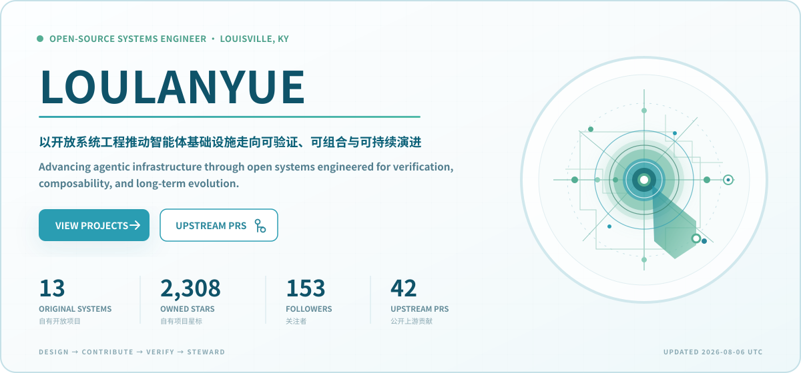
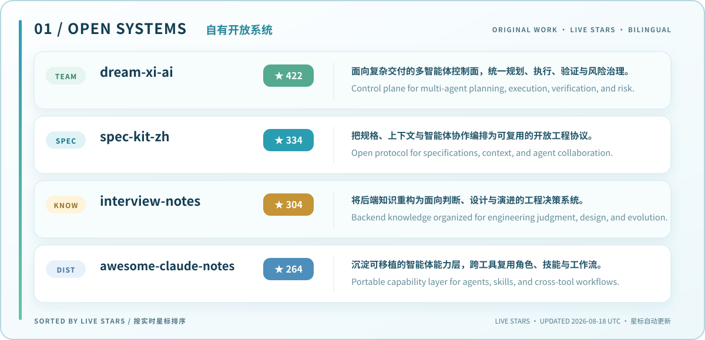
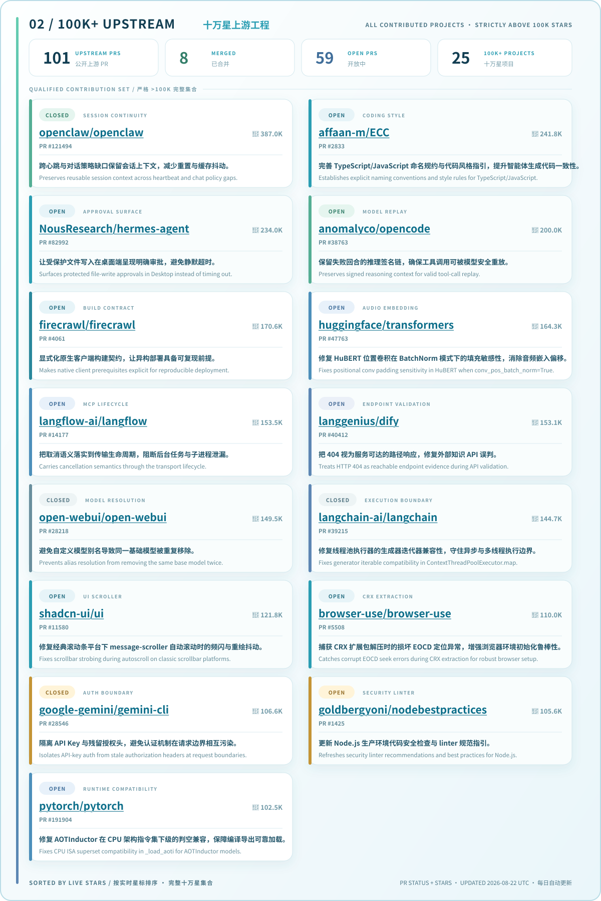
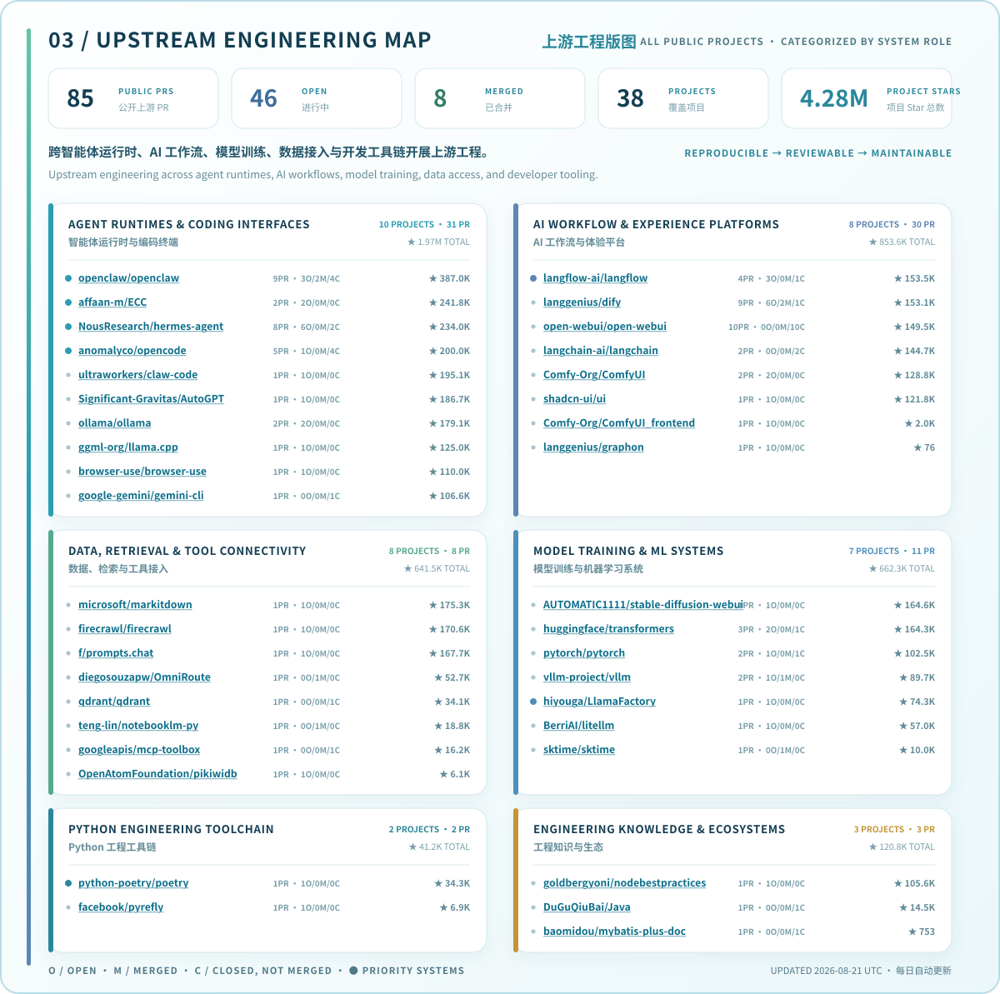

<p align="center">
  <a href="https://github.com/loulanyue?tab=repositories">
    
  </a>
</p>

<p align="center">
  
</p>

<p align="center"><a href="https://github.com/loulanyue/spec-kit-zh"></a>&nbsp;<a href="https://github.com/loulanyue/dream-xi-ai"></a>&nbsp;<a href="https://github.com/loulanyue/awesome-claude-notes"></a>&nbsp;<a href="https://github.com/loulanyue/interview-notes"></a></p>

<p align="center">
  
</p>

<p align="center"><a href="https://github.com/openclaw/openclaw/pull/114596"></a>&nbsp;<a href="https://github.com/NousResearch/hermes-agent/pull/71997"></a>&nbsp;<a href="https://github.com/anomalyco/opencode/pull/38763"></a>&nbsp;<a href="https://github.com/firecrawl/firecrawl/pull/4061"></a>&nbsp;<a href="https://github.com/langflow-ai/langflow/pull/14177"></a>&nbsp;<a href="https://github.com/langgenius/dify/pull/39636"></a>&nbsp;<a href="https://github.com/open-webui/open-webui/pull/27585"></a>&nbsp;<a href="https://github.com/langchain-ai/langchain/pull/39215"></a>&nbsp;<a href="https://github.com/google-gemini/gemini-cli/pull/28546"></a>&nbsp;<a href="https://github.com/pytorch/pytorch/pull/191904"></a>&nbsp;<a href="https://github.com/huggingface/transformers/pull/47763"></a></p>

<p align="center">
  
</p>

<details>
<summary><strong>ALL UPSTREAM PROJECTS / 全部上游项目（24）</strong></summary>
<br />

**Agent runtimes & coding interfaces / 智能体运行时与编码终端** · [openclaw](https://github.com/openclaw/openclaw) · [hermes-agent](https://github.com/NousResearch/hermes-agent) · [opencode](https://github.com/anomalyco/opencode) · [gemini-cli](https://github.com/google-gemini/gemini-cli)

**AI workflow & experience platforms / AI 工作流与体验平台** · [langchain](https://github.com/langchain-ai/langchain) · [langflow](https://github.com/langflow-ai/langflow) · [dify](https://github.com/langgenius/dify) · [open-webui](https://github.com/open-webui/open-webui) · [ComfyUI_frontend](https://github.com/Comfy-Org/ComfyUI_frontend)

**Data, retrieval & tool connectivity / 数据、检索与工具接入** · [firecrawl](https://github.com/firecrawl/firecrawl) · [qdrant](https://github.com/qdrant/qdrant) · [notebooklm-py](https://github.com/teng-lin/notebooklm-py) · [OmniRoute](https://github.com/diegosouzapw/OmniRoute) · [mcp-toolbox](https://github.com/googleapis/mcp-toolbox)

**Model training & ML systems / 模型训练与机器学习系统** · [transformers](https://github.com/huggingface/transformers) · [pytorch](https://github.com/pytorch/pytorch) · [vllm](https://github.com/vllm-project/vllm) · [litellm](https://github.com/BerriAI/litellm) · [LlamaFactory](https://github.com/hiyouga/LlamaFactory) · [sktime](https://github.com/sktime/sktime)

**Python engineering toolchain / Python 工程工具链** · [poetry](https://github.com/python-poetry/poetry) · [pyrefly](https://github.com/facebook/pyrefly)

**Engineering knowledge & ecosystems / 工程知识与生态** · [Java](https://github.com/DuGuQiuBai/Java) · [mybatis-plus-doc](https://github.com/baomidou/mybatis-plus-doc)

</details>

## `SYSTEMS THESIS / 系统主张`

```text
ZH  连接自有系统与上游基础设施，把可复现的问题转化为可审查、可维护、可持续演进的公共工程
EN  Connecting original systems with upstream infrastructure—turning reproducible failures into reviewable, maintainable, and evolvable public engineering
```

<p>
  
  
  
  
  
  
</p>

## `OPERATING PRINCIPLES / 工程原则`

```text
01  THINK IN SYSTEMS / 系统思考    02  GROUND IN EVIDENCE / 证据驱动    03  DESIGN FOR REVIEW / 面向审查    04  MAINTAIN FOR LONGEVITY / 长期维护
```

<p align="center">
  <a href="https://github.com/pulls?q=is%3Apr+author%3Aloulanyue"></a>
  <a href="https://github.com/loulanyue?tab=repositories"></a>
</p>

<p align="center">
  <sub>自有项目统计公开、非 Fork 仓库；上游统计公开 PR 及其项目 Stars。数据每日自动刷新。<br />Owned-project telemetry covers public non-fork repositories; upstream telemetry covers public PRs and total stars across their projects. Refreshed daily.</sub>
</p>
